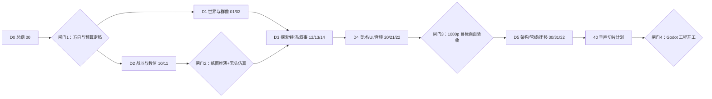

# 《尘缘问道》设计文档体系索引

本目录存放《尘缘问道》（*Seeking Immortality through Mortal Bonds*）的全套设计规格文档。所有子系统遵循统一的十节模板与系统预算纪律，详见本索引说明。

## 1. 文档清单与当前状态

| 编号 | 文档路径 | 名称 | 核心内容 | 依赖 | 必审闸门 | 状态 |
|---|---|---|---|---|---|---|
| **00** | [`00-gdd.md`](00-gdd.md) | 游戏设计总纲（GDD） | 定位、目标玩家、四大体验支柱、核心命题与多结局、全作体量与半开放结构、13 项系统预算、制作管线假设、切片验收标准 | — | ★ 闸门 1 | **已定稿合入（v1.0）** |
| **01** | [`01-world-bible.md`](01-world-bible.md) | 世界观圣经 | 九州地理六大区域、天门崩裂历史真相、修真七大境界与寿元/灵根法则、宗门势力、五行与奇门阵法世界观依据、标准术语表 | 00 | ★ | **已定稿（v1.0）** |
| **02** | [`02-story-and-cast.md`](02-story-and-cast.md) | 主线剧情与群像角色 | 顾长青执道弧光、镜像宿敌、7–8 位可招募队友（含四故人重构与新角色）、8–10 章大纲、羁绊冲突、三结局触发条件 | 00, 01 | ★ | **已定稿（v1.0）** |
| **10** | `10-combat-system.md` | 战斗系统设计 | 半即时 ATB 时间轴、行动资源、五行相生相克与场地气机、四象阵法与阵眼轮转、武技/仙术/合击、灵宠占槽规则、破绽与部位、Boss 设计规范、三档难度 | 00 | ★ 闸门 2 | 待访谈起草 |
| **11** | `11-progression-and-math.md` | 成长与数值总表 | 属性模型、全局收益预算分配表、境界突破与天劫战、技能树、装备与炼器、本命法宝、章节数值曲线与仿真矩阵指标 | 10 | ★ 闸门 2 | 待访谈起草 |
| **12** | `12-exploration-and-levels.md` | 探索、区域与迷宫关卡 | 六大区域半开放连接、大地图与中期御剑飞行、境界软门槛、城镇生活感、明雷遇敌与速斩、五行迷宫机关、支线结构 | 00, 01, 10 | — | 待起草 |
| **13** | `13-economy-and-crafting.md` | 经济、炼丹与炼器 | 货币与灵材产出消耗闭环、炼丹（丹药/破境/剧情救治）与炼器（词条定刻/法宝升炼）分工、门派商店与声望折扣、灵脉派遣规则、防套利审计 | 11 | — | 待起草 |
| **14** | `14-narrative-design.md` | 叙事演出与支线系统 | 立绘规格与表情差分、对话流与抉择记录、过场演出编排、队友夜话/茶叙羁绊、门派声望事件、多结局判定状态机 | 02 | — | 待起草 |
| **20** | `20-art-bible.md` | 美术圣经 | 国风古典手绘基调、参考板拆解、头身比与斜俯视透视网格、全局色板与光影、角色 8 方向少帧规格、场景分层、UI 器物质感、AI 初稿+人工精修管线与确权台账 | 00, 01 | ★ 闸门 3 | 待访谈起草 |
| **21** | `21-ui-ux-spec.md` | UI/UX 与交互规范 | 1920×1080 布局栅格、行囊/修行菜单层级、ATB 战斗 HUD、唯一通知中枢与优先级队列、键鼠+手柄唯一输入映射表、字阶规范、无障碍设置 | 10, 20 | — | 待起草 |
| **22** | `22-audio-direction.md` | 音乐与音效设计 | 古典民乐配器基调、区域与战斗曲目清单、ATB 行动与五行法术分级音效、环境音景、混音分轨与持久化设置、素材商用许可规范 | 00 | — | 待起草 |
| **30** | `30-tech-architecture-godot.md` | Godot 4 技术架构 | 工程目录、Resource 数据驱动、规则/状态/表现三层分离、存档信封与 9 条容错铁律、场景流式加载、本地化 CSV/PO 抽取、无头战斗仿真器与自动化校验 | 10, 11 | — | 待起草 |
| **31** | `31-content-pipeline.md` | 内容生产与质检管线 | 配表规范、对话脚本语法、AI 美术精修验收单、`art-manifest` 校验器、章节关卡白盒→精修流程 | 20, 30 | — | 待起草 |
| **32** | `32-prototype-migration.md` | 原型资产取舍与迁移清单 | 原型 `chenyaun-v2` 逐项处置表（保留重构 / 仅借方法 / 彻底废弃），确保不带入历史包袱与未确权资产 | 01, 02, 10 | — | 待起草 |
| **40** | `40-vertical-slice-plan.md` | 第一章垂直切片实施计划 | 1–2 小时切片的精确地图、NPC、怪物、Boss、3 丹方、装备表、里程碑拆解与外部真人试玩验收方案 | 全部前序 | ★ 闸门 4 | 待访谈起草 |

---

## 2. 子系统文档统一十节模板

除 `00-gdd.md`、`01-world-bible.md`、`32-prototype-migration.md` 外，所有玩法、表现与工程子系统文档必须包含以下十节：

1. **设计目标**：服务哪条体验支柱，为玩家提供什么核心乐趣或情绪。
2. **玩家体验**：玩家在 30 秒（单次交互）、5 分钟（单场战斗/探索段）、1 小时（章节循环）三个尺度上的具体感受。
3. **核心规则**：完整、无歧义、可直接编码或配表的规则定义与边界条件。
4. **数值与预算**：核心公式、参数范围，以及在 `11-progression-and-math.md` 全局收益预算中所占的确切份额。
5. **跨系统接口**：输入依赖哪些系统、输出影响哪些系统（每个系统必须与至少 2 个其他系统形成实质耦合，禁止孤岛系统）。
6. **界面、控制与反馈**：信息展示层级、键鼠/手柄按键映射（引用 `21-ui-ux-spec.md` 全局输入表）、通知中枢优先级。
7. **内容资产需求**：全作与第一章垂直切片各自所需的文本、美术、音效条目估算。
8. **原型反模式与防呆纪律**：原型 `chenyaun-v2` 在该领域踩过的具体坑，以及本设计从机制上杜绝重犯的硬约束。
9. **验收标准**：无头仿真指标 + 实机可观测检查项 + 真人试玩观察点。
10. **开放问题与决策记录**：历次拍板结论及变更原因。

---

## 3. 四道评审闸门

- **闸门 1（当前）**：确认 `00-gdd.md` 的核心定位、13 项系统预算硬边界与垂直切片范围。
- **闸门 2**：`10-combat-system.md` 与 `11-progression-and-math.md` 完成后，先编写独立脚本仿真器验证普通战节奏、五行阵法策略收益与 Boss 机制容错，不做“先写完 UI 再发现不好玩”的返工。
- **闸门 3**：`20-art-bible.md` 必须附带 4 张 1920×1080 实际尺寸目标样片（城镇斜俯视、迷宫机关、ATB 战斗同屏、立绘对话演出），消除“塑料感”后再启动切片资产生产。
- **闸门 4**：全套设计闭合、`40-vertical-slice-plan.md` 拍板后，正式初始化 Godot 4 代码库进入第一章切片开发。
